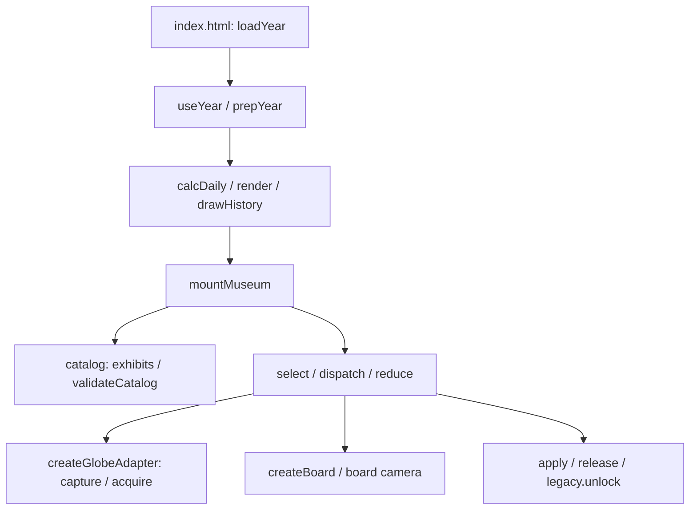

# 01. Current application audit

[Index](00_START_HERE.md) · Next: [architecture](02_ARCHITECTURE_AND_ADRS.md)

## Contents

[Inspection basis](#inspection-basis) · [Repository and runtime](#repository-and-runtime) · [Current call graph](#current-call-graph) · [FIRMS coverage](#firms-coverage) · [Museum contracts](#museum-contracts) · [Integration seams and gaps](#integration-seams-and-gaps) · [Preserve and verify](#preserve-and-verify)

## Inspection basis

Read the complete live discovery specification and instruction prompt, all nine original handoff documents, the current application source/manifests, relevant framework documentation bundled in its ZIP, and data payloads. No separate `MUSEUM_PROTOTYPE_ARCHITECTURE_PLAN.md` was attached. The historical handoff's mock-only instructions have been superseded for this integration stage.

`Current project.zip` SHA-256: `5aba5086d21bb9e269b079073adac7a93fe180c2157bc558620255e795b419fc`. Paths below are **relative to its root**, not the documentation ZIP. Existing symbols are named alongside paths. JSON fields and script exports serve as symbols for data assets. The archive contains 24,146 entries, including Windows dependencies and `.next` caches. These are not deployment inputs to preserve. Inspection extracted reference copies without executing project scripts or changing source.

## Repository and runtime

| Existing path and symbol | Confirmed behavior |
|---|---|
| `web/package.json::{scripts,dependencies}`; `web/package-lock.json::lockfileVersion` | npm, lockfile v3; Next 16.4.6, React/React DOM 19.3.0; TypeScript, ESLint, Vitest. Scripts: `dev`, `build`, `start`, `lint`, `test`, `check:museum` |
| `web/next.config.ts::nextConfig` | `cacheComponents: true`, `partialPrefetching: true`; traces artifact files into three `/api/v1` routes |
| `web/app/page.tsx::Home`; `web/app/components/HistoryView.tsx::HistoryView` | React history entry page; links to the standalone globe |
| `web/public/globe/index.html::{st,loadYear,render}` | Independent browser ES module in HTML; not a React component |
| `web/public/globe/index.html::{globe,HX,ensurePlanMap}` | Hosted globe.gl 2.27.2, h3-js 4.1.0; separate Leaflet planning view loaded on demand; no npm globe dependency |
| `web/lib/artifacts.server.ts::loadArtifactsFromFs` | Existing Node filesystem backend, cached Promise reading `public/artifacts/latest.json` and versioned binaries |
| `web/app/api/v1/{series,validation,export.csv}/route.ts::GET` | Monthly history, validation and CSV export, not documentary discovery |
| `web/lib/harmonize.ts::monthlySeries`; `web/lib/csv.ts::parseSeriesParams` | Existing monthly aggregation/query interface, unsuitable for deriving daily occurrence windows |
| `pipeline/src/firespire/{ingest,globe,fetch}.py::{discover,build_year,load_key}` | Python preprocessing and separate FIRMS download support; not an HTTP backend |
| `web/README.md::Artifacts`; `web/README.md::Firespire web` | Documents deployment to Vercel with `web/` as Root Directory; deployment account/configuration was not provided |
| `web/vitest.config.ts::test`; `web/tsconfig.museum.json::include` | Node Vitest tests under `lib/__tests__/**/*.test.ts`; separate strict checkJS for museum `.mjs` and `.d.ts` |
| `web/.env.example::FIRMS_MAP_KEY`; `web/.gitignore` env patterns | Server-key placeholder exists; `.env*` ignored except `.env.example`; no Brave/Tavily integration in inspected application source |

No checked-in Vercel configuration or CI workflow was found among non-cache archive entries. Do not claim an existing hosted URL, account plan or successful deployment from the README alone.

The supplied `web/AGENTS.md` requires matching framework docs. Relevant inspected files under `web/node_modules/next/dist/docs/01-app/`: `01-getting-started/15-route-handlers.md`, `02-guides/environment-variables.md`, and `03-api-reference/03-file-conventions/02-route-segment-config/{maxDuration,runtime}.md`. In this exact version, Cache Components requires **omitting even `runtime = 'nodejs'`**. Use default Node and `maxDuration = 60`; do not copy older route boilerplate with `dynamic`, `revalidate` or an explicit runtime.

## Current call graph

At startup `web/public/globe/index.html::loadYear(st.year).then(...)` loads the latest available year, selects its peak day, renders, and imports `museum/index.mjs::mountMuseum`. `range()` returns the selected day or the week/month/year from `period()`. `pass(i)` applies confidence, day/night and province. Visual H3 resolution and intensity layer toggles are rendering settings, not documentary incident filters.

`st = {year,conf,dn,prov,end,scale,day,res,layers,mode,shape}`. There is **no country picker, arbitrary start/end interval or custom polygon selector** in this snapshot. `fTerr` is Argentina province index, `-1` means all provinces. Province names/geometry come from `web/public/globe/data/provincias.js::PROVINCIAS`. Custom inputs must be added minimally, not described as already implemented.

## FIRMS coverage

### Globe data, measured from actual payloads

`web/public/globe/data/years.js::YEARS` and `data-YYYY.js::FOCOS[year]` contain:

| Year | Aggregated rows | Sum of detection counts | First/last populated date | Populated days |
|---|---:|---:|---|---:|
| 2023 | 96,333 | 211,651 | 2023-01-01 to 2023-12-31 | 365 |
| 2024 | 102,792 | 207,624 | 2024-01-01 to 2024-12-31 | 366 |
| 2025 | 105,268 | 218,444 | 2025-01-01 to 2025-12-31 | 365 |
| 2026 | 40,104 | 118,204 | 2026-09-01 to 2026-11-14 | 75 |

Payload contract: `{step:0.1,inst:[...],cols:{day,inst,dn,conf,prov,iy,ix,n,f}}`. `day` is zero-based UTC day-of-year; `inst` 0/1 is MODIS/VIIRS family; `dn` 0/1 is night/day; confidence class 0/1/2; `n` count, `f` summed FRP. Derived cell center is `lat=(iy+.5)*.1-90`, `lon=(ix+.5)*.1-180`. This is **not an original acquisition coordinate** and contains no per-row satellite ID or acquisition time. Sources: `prep.py` year grouping and `pipeline/src/firespire/globe.py::{_read,build_year}`.

Globe province assignment can use a nearest-region fallback up to 0.3 degrees (`pipeline/src/firespire/globe.py::assign_provinces`, `NEAREST_MAX_DEG`; also `prep.py::assign`). Thus a globe province index is not rigorous raw point-in-polygon proof. Custom polygon discovery must use original coordinates, not rounded cell centers.

### Original CSVs supplied

| File under `fuentes/` | Rows | Acquisition-date coverage |
|---|---:|---|
| `modis_2023_Argentina.csv` | 47,910 | 2023-01-01 to 2023-12-31 |
| `viirs-jpss1_2023_Argentina.csv` | 163,741 | 2023-01-01 to 2023-12-31 |
| `modis_2024_Argentina.csv` | 49,843 | 2024-01-01 to 2024-12-31 |
| `viirs-jpss1_2024_Argentina.csv` | 157,781 | 2024-01-01 to 2024-12-31 |

Fields inspected include latitude, longitude, `acq_date`, `acq_time`, satellite, instrument, confidence, FRP, daynight, version and type. The totals match 2023/2024 globe counts. This does not prove every source row is correct or satellite coverage is complete. It establishes a traceable local starting point. No original 2025 or 2026 CSV was included in the provided source snapshot. Existing derived files remain visible, but the proposed strict discovery index initially certifies only 2023–2024. Missing provenance/coverage for other slices is reported explicitly.

Measured **globe**, unfiltered province monthly counts: Córdoba (`PROVINCIAS[6]`) September 2024: **5,248**; Corrientes (`PROVINCIAS[5]`) February 2023: **11,916**. Exact discovery counts may differ because the proposed index uses raw coordinates and explicit polygon clipping. These totals are detections, not incidents or a severity comparison.

### Harmonized History is a separate data product

`web/public/artifacts/latest.json::version` is `v1-nrt`. Its `meta.json` has `first_month=2023-01`, `n_months=47`, `first_provisional_month=2026-09`, `n_cells=7796`, `h3_res=5`. Both sensor families list **2025-01 through 2026-08 as months_without_data**. `v0/meta.json` covers 24 months from 2023-01. Thus the History span is not continuous observed coverage, and it contradicts any assumption that the globe and History contain identical years. Preserve both and explain the distinction.

History preprocessing filters type/confidence and persistent cells (`meta.json::filters`, `pipeline/src/firespire/filters.py`); the globe preprocessing does not filter type. Discovery uses the selected globe confidence/daynight settings with raw records, does not alter History calibration, and labels thermal activity as context rather than confirmed wildfire.

`prep.py` references absent `fuentes/provincias_ign.json` and retains only one path per VIIRS family/year. Do not run it to regenerate the app. The newer `pipeline/src/firespire/globe.py::run` supports multiple files and the supplied `pipeline/resources/provincias.geojson`, but regeneration is unnecessary for documentary integration.

## Museum contracts

| File/symbol | Existing restriction or invariant |
|---|---|
| `museum/contracts.d.ts::{MockExhibit,MockEvidence}` | `isMock:true`, source URL `null`, verification `fictional`; evidence kinds article/report/photo/satellite; fixed placements |
| `museum/catalog.mjs::{BOARD,exhibits}` | `BOARD` 1600×1000 and two authored exhibits; renderer and camera import BOARD from the fictional catalog |
| `museum/validate.mjs::validateCatalog` | Rejects live flags/URLs; enforces global ID uniqueness including source IDs, finite coordinates, placements inside fixed BOARD and same-exhibit edges |
| `museum/index.mjs::mountMuseum` | Builds markerRecords once from imported catalog; labels markers/intro fictional; no selection subscription or live loading |
| `museum/index.mjs::{select,dispatch,INTRO_MS}` | Captures camera and legacy state; starts 5,000 ms countdown on selection, including approach; creates board synchronously during selection |
| `museum/state.mjs::{Stage,reduce}` | globe → approach → intro/entering → board/travel/evidence → returning; session/motion tokens reject stale callbacks and repeated Start |
| `museum/board-view.mjs::{createBoard,renderEvidence}` | Physical DOM cards, SVG strings, scrollable paper bodies; camera transforms world; source footer currently has name/date, **no link**; image path restricted to local assets |
| `museum/board-camera.mjs::{overviewPose,focusPose,travelSpec,cameraMatrix}` | Whole-board sizing uses global BOARD; focus uses each placement; travel changes camera translation/scale/roll without moving evidence |
| `museum/globe-adapter.mjs::{capture,acquire,apply,release}` | Saves camera position/quaternion/up, OrbitControls target/settings, projection and view offset; exclusive camera lease |
| `index.html::museumLegacy::{lock,unlock}` | Preserves st, layers copy, dataset/year payload, scroll, settings popup and rotation timer; makes legacy panels inert |
| `museum/annotations.mjs::{waypointHelp,boardHelp,itemHelp,edgeHelp}` | Documentary explanations currently describe fictional or future integration |
| `museum/developer-overlay.mjs::createDeveloperOverlay` | Permanent bottom-left switch, per-element metadata, mouse/touch/keyboard popovers; uses DOM text |
| `museum/dom.mjs::element` | Uses `textContent`; preserve that safe rendering path |

Paths in this table are under `web/public/globe/` unless starting `index.html`, which is also in that directory.

## Integration seams and gaps

Add request routes beside the existing `/api/v1` routes, with separate `web/lib/museum/*.server.ts` modules. Extend `museumLegacy()` with a **proposed** selection-read/subscription contract; do not reach into module-local `st` from another script or scrape rendered labels. Extend `mountMuseum()` with replaceable live exhibits, preserving its state machine and adapter.

Move the neutral BOARD default into a **proposed** `board-layout.mjs` so camera/rendering no longer load the fictional catalog in live mode. Keep the catalog only as a test fixture or explicitly labeled isolated prototype mode. Add separate live validation; do not simply remove assertions from `validateCatalog`.

Custom-area and interval inputs, cause filters, status notices and original-source links are necessary integration work. No new theme, React migration, planning-map rewrite, sensor harmonization change, predictive claims or global geocoder is warranted.

## Preserve and verify

Read-only Node assertions were executed against existing modules: two-exhibit validation, repeated Start rejection, stale callback rejection after exit, and camera centering at desktop and narrow viewports. All passed. The existing Vitest suite, npm install/build/lint/typecheck and browser interaction tests were **not run** in this architecture task. Historical results in `docs/museum-prototype.md` are prior author claims, not new verification.

Preserve `state.mjs::reduce`, `globe-adapter.mjs`, motion durations/abort tokens, camera interpolation, existing H3 rendering and planning controls. Extend tests around them when adding asynchronous discovery. Full acceptance is in [08](08_TESTING_FAILURES_AND_RELEASE.md).
