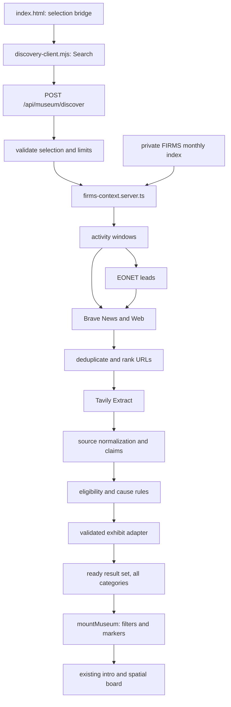

# 02. Architecture and decisions

[Index](00_START_HERE.md) · [Audit](01_CURRENT_APPLICATION_AUDIT.md) · [Contracts](05_DATA_CONTRACTS_AND_UI_INTEGRATION.md)

## Contents

[Architecture](#architecture) · [Ownership and files](#ownership-and-files) · [Decision records](#decision-records) · [Request lifecycle](#request-lifecycle) · [Budgets and caching](#budgets-and-caching) · [Security and deployment limits](#security-and-deployment-limits)

## Architecture

Use the existing Node-backed Next.js App Router (`web/app/api/v1/series/route.ts::GET`, `web/lib/artifacts.server.ts::loadArtifactsFromFs`) and documented Vercel target (`web/README.md`). The legacy globe remains a same-origin static HTML client. No Python server, separate service, database, worker queue, provider SDK or language model is required.

All new module names in the diagram are **proposed**. Existing symbols and their source citations are cataloged in [01](01_CURRENT_APPLICATION_AUDIT.md#museum-contracts). `mountMuseum`, `createBoard`, `reduce` and the globe adapter remain the presentation backbone.

## Ownership and files

| Proposed path | Responsibility / exported boundary |
|---|---|
| `web/lib/museum/contracts.ts` | Normalized public types, no environment reads |
| `web/lib/museum/validate.ts` | Runtime request/result checks, strict URL/date/geometry schemas |
| `web/lib/museum/discover.server.ts` | `discover(query, context): Promise<DiscoveryResult>`; sole orchestration/budget owner |
| `web/lib/museum/firms-context.server.ts` | Read validated local shards; exact point clipping; per-product activity windows |
| `web/lib/museum/providers/{http,eonet,brave,tavily,firms}.server.ts` | Fetch, bounds, timeouts, provider errors and mappings |
| `web/lib/museum/normalize.ts` | Canonical URL, supported location/date mentions, source identity |
| `web/lib/museum/causes.ts` | Candidate sentences, authority gates, claim status and cause precedence |
| `web/lib/museum/waypoints.ts` | Eligibility and conservative grouping; no rendering |
| `web/lib/museum/authorities.ts` | Small jurisdiction/domain registry with independent authority basis, never incident content |
| `web/lib/museum/cache.server.ts` | Bounded in-process cache and local request limiter; explicitly nondurable |
| `web/lib/museum/adapter.ts` | `toLiveExhibit(waypoint, records): LiveExhibit`; validated complete payload |
| `web/app/api/museum/discover/route.ts` | POST validation/origin guard, cancellation, JSON result |
| `web/app/api/museum/status/route.ts` | GET configuration/coverage booleans, no secret values, no paid calls |
| `web/scripts/build-discovery-data.mjs` | Offline Node generation of private shards from supplied CSVs |
| `web/scripts/probe-providers.mjs` | Explicit operator smoke request for each provider; never dumps secrets/full source text |
| `web/data/museum/{coverage.json,boundaries.json,YYYY-MM.json}` | Generated nonpublic deployment inputs; source hashes and acquisition records |
| `web/public/globe/museum/discovery-client.mjs` | Request generation/abort, result validation, status, all-category store |
| `web/public/globe/museum/discovery-controls.mjs` | Search/date/custom-area inputs and independent cause toggles |
| `web/public/globe/museum/board-layout.mjs` | Neutral default dimensions and deterministic variable layout |
| `web/public/globe/museum/live-contracts.d.ts` | Browser type import/re-export of public types plus renderer types |
| `web/public/globe/museum/live-validate.mjs` | Standalone browser runtime validation of live exhibits |

Existing files to extend: `web/public/globe/index.html::{museumLegacy,render}`, museum `index.mjs::{mountMuseum,refresh,fillIntro,select}`, `board-view.mjs::{createBoard,renderEvidence}`, `board-camera.mjs::overviewPose`, `annotations.mjs` helpers, `contracts.d.ts`, `museum.css`; `web/next.config.ts::outputFileTracingIncludes`, `web/.env.example`; test files under `web/lib/__tests__/`. Do not modify unrelated History/pipeline behavior.

## Decision records

### ADR 1: one bounded foreground request

**Choose** POST returning a complete or honest partial result within a 50-second work deadline, route `maxDuration=60`. A partial result contains only fully prepared waypoints. No durable job IDs, polling or background work after response. Alternative queue/job architecture would require new operational infrastructure; an unpersisted job Map would break across Vercel instances. Streaming is unnecessary to prove the slice and does not remove function time limits. If the 50-second budget expires before any usable source, report timeout/partial, not a completed empty search.

### ADR 2: reuse raw local FIRMS for exact geometry

**Choose** one offline Node indexing script for supplied 2023/2024 CSVs and a private runtime JSON reader. This avoids costly NASA calls for data already present and avoids treating 0.1-degree globe grid centers as raw detections. Preserve original CSVs and globe assets. Alternative direct parsing of each CSV per request wastes time; trusting browser-supplied counts permits fabricated anchors; using monthly History loses daily and point precision. The build script is small preprocessing, not a new backend.

2025/2026 globe files are retained by the existing renderer. Their absent original CSV provenance is isolated as a discovery coverage gate. The optional FIRMS adapter may serve a missing short slice only after availability verification; it is not a promise to retrieve arbitrary archives today.

### ADR 3: explicit search, immutable exhibit session

**Choose** a Search button seeded from `index.html::range()` and selected province, with optional start/end override and custom GeoJSON upload. Geographic/date/confidence/daynight changes mark results stale and abort pending work. Camera rotation, visual resolution and thermal layer changes do not spend quota. Cause toggles are local. This implements automatic discovery from the selected area without automatically billing every slider change.

Once a ready waypoint is clicked, freeze its exhibit revision and query/filter snapshot for the existing `select`/`dispatch` flow. No network operation is needed during the intro. A result refresh cannot replace evidence while the visitor is on the board.

### ADR 4: deterministic interpretation with narrow authority gates

**Choose** local ES/EN sentence/date/place rules and an agency capability registry. No LLM dependency. Extraction locates candidate statements; classification applies explicit, auditable checks in [04](04_DISCOVERY_AND_CAUSE_ENGINE.md). Unknown is an expected useful result. Domain trust alone, source rankings, snippet language or model confidence cannot establish a cause. Broad parsing coverage is traded for lower false attribution. Unrecognized prose stays unknown or ineligible, with reasons.

### ADR 5: URL-first exhibits, conservative grouping

**Choose** one qualifying source as the stable anchor. Additional evidence joins only through an explicit citation/incident identifier and compatible occurrence/location. Nearby results remain separate. Region-level documentation receives a labeled region locator, never an invented ignition point. Empty boards and duplicate cards added for visual balance are forbidden.

### ADR 6: bounded local cache, protected demonstration deployment

**Choose** in-process LRU cache as an optimization, not a database or global quota controller. Local demo and access-protected Vercel preview are the day-one deployment modes. Public unauthenticated deployment requires platform-enforced rate controls and provider spend caps verified first. Do not claim memory counters protect a distributed deployment. A persistent store is deferred only for hardening; actual live discovery is not deferred.

### ADR 7: preserve camera and renderer, remove mock-only coupling

**Choose** a distinct `LiveExhibit` and validator, mapping normalized records into the existing placement/body/fields contract. Extend dimensions per exhibit. Preserve `state.mjs::reduce`, `globe-adapter.mjs`, `focusPose`, `travelSpec`, the board world transform and the five-second countdown. Remove runtime catalog imports from live camera/render paths. Alternative rewriting the museum in React has no demonstrated benefit for today's requirement.

### ADR 8: deliberate scope and specification resolutions

The specification's proposed bbox-only request is replaced by validated administrative IDs or polygon geometry, because bbox alone cannot represent the selected province. A geographic label supplied by a client is display-only until checked against boundaries. The original mock-only handoff is historical. The functional requirements take precedence over the prototype's independent-of-calendar fictional markers. The prior “parallel layers” concept is preserved visually, while the new discovery orchestration is explicitly FIRMS-first. No product decision is reopened.

## Request lifecycle

1. **idle/stale:** controls remain usable; no provider traffic. Configuration/coverage status can be read once.
2. **validating:** enforce 32 KiB request, valid ISO dates, 1–366 days, supported area; derive trusted boundary. Return 400/413 for bad input. Reject antimeridian geometries with an explicit unsupported-area code today.
3. **FIRMS context:** load exact matching daily points. No observations with known coverage → `no_activity`; unavailable or uncertain coverage → `historical_data_unavailable`. Neither makes provider requests.
4. **discovering:** EONET and base Brave search begin after positive context. EONET failure/zero does not cancel Brave. Later Brave slots use real discovered titles/place/time and agency scopes.
5. **extracting/classifying:** retrieve selected URLs; preserve per-URL failures; apply location/time/cause/eligibility rules; no waypoint publication yet.
6. **ready/partial:** serialize only valid complete exhibits and provenance; client atomically replaces the matching result set. Display counts for hidden categories and warnings.
7. **selection changed/cancelled:** abort browser fetch; request signal and global deadline abort provider fetches. Generation counter rejects late replies even if abort arrives too late. Already incurred provider charges cannot be undone.
8. **board open:** freeze results and disable discovery controls except Developer View/exit. Restore filters and selection before accepting pending refreshes after return. No automatic refresh starts on exit.

HTTP 200 includes completed semantic outcomes such as no activity or no eligible sources. HTTP 503 means discovery cannot run because required configuration is absent; 502 means unusable provider responses and no usable result; 429 local rate cap; 504 global timeout with no useful output. With usable exhibits plus failures return 200 `partial`, never discard evidence just because another provider failed.

## Budgets and caching

These are **application choices**, not claims about provider limits.

| Resource | Day-one cap |
|---|---|
| Input area/time | Argentina country/province/custom polygon; 366 days; 500 vertices, 20 rings, no antimeridian |
| Activity windows | Two non-overlapping 7-day windows, selected within the query; expose searched windows and skipped-window count |
| EONET | One selected-area request, 50 results, 6-second timeout; saturation yields coverage warning |
| Brave | Six total calls including retries/pagination; max one in flight and 1.1 seconds between starts; 5-second timeout each |
| Extraction | Up to eight URLs, one basic batch, 10-second provider timeout and 12-second transport timeout; optional one advanced retry only within eight-URL/credit budget and deadline |
| Source processing | At most 200,000 characters per source, eight sources, no executing HTML; over-cap text loses official-classification eligibility if relevant context may be truncated |
| Results | At most eight primary exhibits, at most ten evidence cards each, total JSON under 1 MiB; excess is explicit `truncated` |
| Work deadline | 50 seconds server; stop new searches at 32 seconds, reserve extraction/normalization; client timeout 65 seconds |
| Local limiter | One active query per client, one active orchestration per process, three starts per client/10 minutes, 30 starts/process/hour; cache hits do not call providers |

Cache key = SHA-256 of canonical area geometry/ID, dates, confidence/daynight, dataset content hash, language, query/normalization/classifier versions and provider enablement. Exclude camera, cause toggles and API key values. Use stable JSON serialization, sorted keys and canonical coordinates; reordered custom rings may miss cache but must never incorrectly share one. No reusable cached exception Promise.

FIRMS immutable shards: cache by dataset hash, up to four monthly shards or 32 MiB. Discovery cache: max 20 responses/16 MiB, TTL 15 minutes for complete, 60 seconds for partial, 2 minutes for valid empty. Upstream 401/403/429/5xx are not negative evidence and are not cached as `no_sources`. TTL **defaults to zero for retained provider-derived results until account storage rights are confirmed** (`MUSEUM_RESULT_CACHE_ENABLED=false`). Active request/session rendering is still necessary; do not persist full text. No localStorage/sessionStorage content cache. Cache hits expose timestamps and provider-call counts. Refresh bypasses permitted result cache, still obeys limits. No automatic stale-while-revalidate jobs.

## Security and deployment limits

Only `.server.ts` modules read keys; no `NEXT_PUBLIC_` keys, client dotenv files, provider URLs containing MAP_KEY in responses, raw response logs, or secret-valued exceptions. Browser calls same-origin `/api/museum/*`. Require JSON and matching `Origin` for paid POST; a missing Origin is permitted only for loopback development or an authenticated deployment-protected operator path. No wildcard CORS, arbitrary proxy endpoint or URL supplied by a visitor for extraction.

URLs entering Tavily must come from server-held search/EONET responses. Reject userinfo, IP literals, localhost/private/reserved addresses, unsupported schemes, nonstandard ports and excessive lengths; prefer HTTPS. No direct arbitrary server fetch fallback today, avoiding a new SSRF crawler. If a provider reports a redirect to another host, its authority must be reassessed. Exact host/path matching, never substring matching for government trust. Search operators are built from length-limited normalized tokens, with user punctuation/operators removed.

Render text through existing `museum/dom.mjs::element`/`textContent`. External links are validated HTTPS and use `target=_blank`, `rel=noopener noreferrer`; they must remain keyboard accessible in evidence view. No HTML injection, raw Markdown rendering, third-party scripts, unrestricted iframes or automatic photograph loading. Extracted text is source data, never executable instructions.

Vercel documentation confirms a 4.5 MB function payload ceiling; the proposed 1 MiB response is deliberately smaller. Current duration documentation lists 300 seconds for Hobby with Fluid Compute, but this design uses at most 60 seconds and requires checking the actual deployment's timeout. Sources: [duration](https://vercel.com/docs/functions/configuring-functions/duration), [limits](https://vercel.com/docs/functions/limitations). Build tracing must include `./data/museum/**/*` for the two new routes. Local memory/files are not durable serverless state. Exact deployment procedure is [07](07_SETUP_RUN_AND_DEPLOY.md#deployment).
