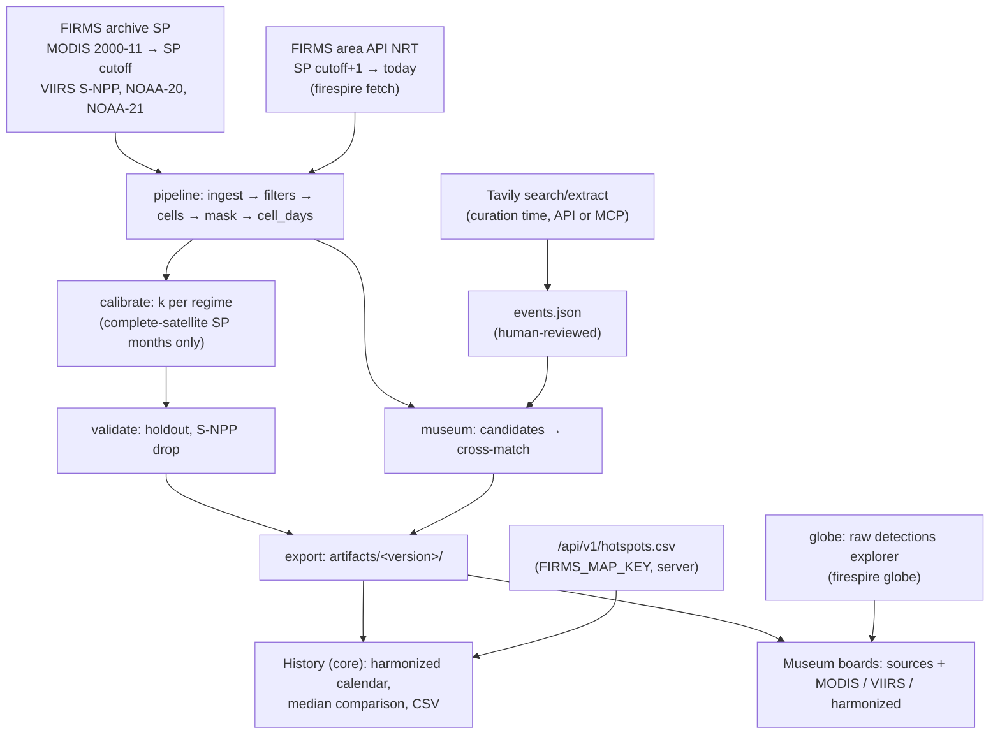

# 02. Architecture and decisions

[Index](00_START_HERE.md) · [Audit](01_CURRENT_APPLICATION_AUDIT.md) · [Contracts](05_DATA_CONTRACTS_AND_UI_INTEGRATION.md)

## Architecture

Everything left of `export` is Python and runs on a team laptop. Everything right of it is static files plus four small Next.js routes on Vercel. There is no database, no queue, no runtime search provider.

## Ownership and files

| Path | Responsibility | New or existing |
|---|---|---|
| `pipeline/src/firespire/config.py` | All thresholds: regimes, mask, museum AOI radius and match thresholds | Existing, extend |
| `pipeline/src/firespire/fetch.py` | Area API download; add SP sources and an output folder per product | Existing, extend |
| `pipeline/src/firespire/calibrate.py` | k per regime; add satellite-completeness guard | Existing, extend |
| `pipeline/src/firespire/museum.py` | `candidates()` ranking and `cross_match()` → `museum.json` | **New** |
| `pipeline/resources/museum/events.json` | Curated, human-reviewed events (input) | **New** |
| `web/lib/artifact-types.ts` | Types for all artifacts, including `MuseumArtifact` | Existing, extend |
| `web/lib/harmonize.ts` | Add `monthBaseline()` (median and anomaly) | Existing, extend |
| `web/app/components/HistoryView.tsx` | Date range, comparison KPI, anomaly view, chart download | Existing, extend |
| `web/app/api/v1/hotspots.csv/route.ts` | FIRMS proxy for raw hotspots of a search | **New** |
| `web/public/globe/museum/curated.mjs` | Loads `museum.json` and maps events to boards | **New** |
| `web/public/globe/museum/curated-validate.mjs` | Validator for curated exhibits (real URLs allowed) | **New** |
| `docs/contratos.md` | Contract for `events.json`, `museum.json`, `hotspots.csv` | Existing, extend |

The three files that change together stay the same: `web/lib/artifact-types.ts`, `pipeline/src/firespire/config.py`, `docs/contratos.md`.

## Decision records

### ADR 1: core first

**Choose** the harmonized calendar as the product spine (closes D-01 as option a). The challenge's two parts are harmonization and a web app that takes harmonized data as input; the museum and globe support that story, they do not replace it. **Rejected:** spending the remaining hours on live documentary discovery (8–16 h by the previous package's own estimate) while the calendar still starts in 2023.

### ADR 2: one method, in Python

**Keep** the existing rule: the method lives only in the pipeline; the web only applies `calibration.json` (serie armonizada = k × VIIRS cell-days from `harmonized_start`). The museum cross-match also runs in Python, so museum numbers and calendar numbers come from the same `cell_days` table and the same k.

### ADR 3: full-archive ingest

**Choose** SP (standard processing) for history and NRT only after the SP cutoff.

- **SP cutoff** = the earliest of the SP max dates across the sources used (from `/api/data_availability` or the files' last `acq_date`). NRT starts at cutoff + 1 for **all** sources, the same common-window rule `fetch.py::window` already applies.
- **Satellite completeness:** a month enters calibration only if the VIIRS satellites observed that month include every satellite the regime expects (`Regime.satellites`). Otherwise it is reported in `meta.warnings` and skipped. This fixes the V3 bias.
- **Limitations declared, not corrected:** MODIS Terra-only from 2000-11 to 2002-07 (D-09); NRT months marked provisional and outside calibration (T-11).
- **Size:** if `monthly.bin` exceeds about 15 MB, serve only the two `uint8` cell-day blocks to the browser in a second file and keep hotspot blocks for the CSV route. Decide after measuring, not before.

### ADR 4: museum is a curated static dataset

**Choose** offline curation over runtime discovery. Steps (detail in [04](04_DISCOVERY_AND_CAUSE_ENGINE.md)):

1. The pipeline ranks candidate fire episodes from the data (harmonized cell-days and anomaly by province and month).
2. A team member documents candidates with Tavily search and extract (API or the Tavily MCP inside a Claude Code session).
3. A person reviews and writes `events.json`: dates, place, lat/lon with its basis, source URLs, short quote, stated cause and category.
4. The pipeline cross-matches each event against FIRMS detections and the harmonized series and writes `museum.json`.

The "mock data" of the museum is therefore **fixed data, not live data**; the events and sources are real and reviewed. **Rejected:** Brave (paid), runtime Tavily (keys and credits at runtime, latency, quota), the deterministic cause engine (low recall, likely empty "official" filter in the demo).

### ADR 5: explicit spatiotemporal link, never attribution

**Choose** to compute and show how FIRMS detections overlap each curated event: area of interest (AOI) × date window. The board says "N detections fell inside this area and period" and never "these detections are this fire". Each event carries a verdict `overlap`, `weak` or `none` with the thresholds used.

This **changes the current globe rule** in `CLAUDE.md` ("Museum of Fires adds a separate documentary layer of fictional exhibits, with visible labels and no inferred links with real detections"). Proposed as team decision **D-14**; until it is approved, Track C stops before wiring `museum.json` into the globe.

### ADR 6: hotspots of a search through a server proxy

**Choose** `GET /api/v1/hotspots.csv?province=&from=YYYY-MM-DD&to=YYYY-MM-DD` that calls the FIRMS area API with `FIRMS_MAP_KEY`, the province bounding box and up to 10 days (two 5-day chunks per source, fetched in parallel), clips points to the province polygon and streams CSV. Raw detections for 26 years are too large to ship as static files. Above 10 days: 400 with a message to narrow the range. Cuttable if time runs out.

### ADR 7: keys

| Key | Where it lives | Used by |
|---|---|---|
| `FIRMS_MAP_KEY` | `web/.env.local` locally; Vercel environment (server) | `firespire fetch`, `/api/v1/hotspots.csv` |
| `TAVILY_API_KEY` | Curator's `web/.env.local` or the Tavily MCP config | Curation only; **never in Vercel** |

No `NEXT_PUBLIC_` key. `fetch.py` already never prints the MAP_KEY; the proxy must not log upstream URLs.

## Deferred: live documentary discovery

The previous package designed `POST /api/museum/discover`: FIRMS activity windows → EONET + Brave News/Web → Tavily Extract → deterministic date, place and cause parsing with five "official final cause" gates → live boards. It stays a sound post-hackathon direction, with two changes when it returns: Tavily Search instead of Brave, and activity windows ranked on harmonized cell-days instead of one sensor's raw counts. Full text: git commit `f6ab34f`, folder `docs/arquitechture-decitions/`.

## Budgets

| Resource | Cap |
|---|---|
| FIRMS API | 5,000 transactions per 10 minutes per key; an area request costs about 4 (`CLAUDE.md`). `fetch` stays well under it with sequential 5-day chunks |
| `hotspots.csv` | ≤ 10 days, one province, ≤ 8 upstream requests, response ≤ 4 MB (Vercel's 4.5 MB function limit) |
| Tavily | Curation only: about 5 basic searches (1 credit each) + 10 basic extracts (1 credit per 5 URLs) per candidate, ≤ 15 candidates → about 105 credits of the 1,000 free monthly credits [estimate from Tavily's published pricing, see 03] |
| `museum.json` | ≤ 5 events, ≤ 1,500 sampled points per event, ≤ 1 MB |
| Static artifacts | Served from `public/`, never through a function |
