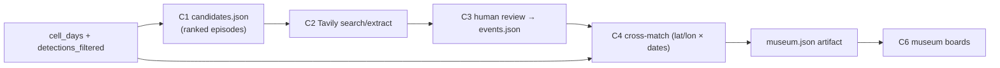

# 04. Museum curation and FIRMS cross-match

[Index](00_START_HERE.md) · [Providers](03_PROVIDER_API_IMPLEMENTATION.md) · [Contracts](05_DATA_CONTRACTS_AND_UI_INTEGRATION.md)

The file keeps its old name; it replaces the live "discovery and cause engine". The museum now answers one question per event: **what did the satellites see, on one harmonized scale, in the place and days a documented fire happened?**

## Overview

## C1. Candidates from the data

Command (new): `uv run firespire museum candidates ../fuentes/sp ../fuentes/nrt --top 15` → `pipeline/out/candidates.json` (not versioned, not an artifact).

1. **Province × month ranking.** From `cell_days`, compute harmonized cell-days per province and month (MODIS before `HARMONIZED_START`, k × VIIRS after; same formula as `harmonize.ts`). For each province and calendar month, compute the median over the other years with data. Score = harmonized cell-days and ratio to that median.
2. **Episode inside the month.** Take the detections of the top province-months from `detections_filtered` (raw lat/lon) and group them: two cell-days belong to the same episode if their H3 cells are neighbors (`grid_disk(cell, 1)`) and their dates are at most 2 days apart. Keep the largest episode per province-month.
3. **Per episode record:** start and end date, peak day, footprint (H3 cells), centroid (mean of raw lat/lon, weighted by detections), bounding box, provinces touched, MODIS and VIIRS cell-days and detections, harmonized cell-days, max FRP, regime, whether the month is provisional.
4. **Diversity rule for the shortlist of 15:** at least one episode before 2012-02 (MODIS only), at least one from 2012 onward where MODIS and VIIRS both observed (to show "MODIS X vs VIIRS 2X, harmonized ≈ X"), at least one recent (2025–2026), and no more than two per province.

Well-known Argentine fires can be checked against the ranking, but the ranking decides; a remembered event that does not show up in the data is a finding, not something to force in.

## C2. Document candidates with Tavily

For each shortlisted candidate (API or MCP, see [03](03_PROVIDER_API_IMPLEMENTATION.md#tavily-curation-only)):

1. Search `incendio {province} {month_es} {year}` restricted to official hosts, then unrestricted. Add the main locality if the centroid falls near a named place the curator recognizes.
2. Optionally add EONET leads for the same bbox and dates.
3. Extract the 2–4 most relevant URLs. Read them.
4. Discard a candidate if no source states a fire in that province with dates overlapping the episode. That is normal: agricultural burning shows up in the data without news coverage.

Budget: about 7 Tavily credits per candidate; 15 candidates ≈ 105 credits.

## C3. Human review → `events.json`

The curator writes 3–5 events in `pipeline/resources/museum/events.json` (schema in [05](05_DATA_CONTRACTS_AND_UI_INTEGRATION.md#eventsjson-curated-input)). Rules:

| Field | Rule |
|---|---|
| Dates | Occurrence dates **as stated by a source**. Publication date is stored separately. If a source only says "early September", use the month and mark `date_precision: "month"` |
| Place | Named place as written in the source, plus province |
| `lat`, `lon` | One of three bases, always recorded in `location_basis`: `stated_coordinates` (the source gives them), `named_place` (the curator places the named locality on a map), `satellite_centroid` (from C1, when the source only names the province). Never present a centroid as an ignition point |
| `radius_km` | AOI radius; default `config.MUSEUM_AOI_KM = 25`. Larger (up to 60) for province-wide events with `satellite_centroid` |
| Area burned | Only if a source states it, with that source's ID |
| Cause | Text as stated by the source, plus a category: `official` (an authority with that role says it, e.g. a prosecutor or fire service report), `reported` (press or other attribution), `unknown` (no cause stated, or "under investigation") |
| Sources | URL, title, publisher, publication date, kind (`article`, `report`, `photo`), quote of at most 25 words. At least one source per event; two or more preferred |
| `curated` | `{by, at, tool}`, e.g. `{"by": "human:<name>", "at": "2026-11-15T16:00:00-03:00", "tool": "tavily-mcp"}` |

Nothing goes in without a URL the curator opened. If a fact cannot be checked, leave it out.

## C4. Cross-match with FIRMS (lat/lon × dates)

Command (new, also run inside `build`): `uv run firespire museum build pipeline/resources/museum/events.json` → `web/public/artifacts/<version>/museum.json`.

For each event:

1. **AOI** = circle of `radius_km` around `(lat, lon)`, clipped to Argentina. **Window** = documented start − `MUSEUM_WINDOW_PAD_DAYS` (3) to documented end + 3. Month-precision dates use the whole month.
2. **Points:** select rows of `detections_filtered` with great-circle distance ≤ `radius_km` and `acq_date` in the window (raw lat/lon, before H3 rounding).
3. **Counts by satellite and family:** detections, cell-days (H3 res 5, distinct per family), max FRP, first and last detection.
4. **Harmonized cell-days** for the window: MODIS cell-days if before `HARMONIZED_START`, else k(regime of each day's month) × VIIRS cell-days. Same k as `calibration.json`.
5. **Daily curve:** per day, MODIS cell-days, VIIRS cell-days, harmonized.
6. **Context:** harmonized cell-days of the AOI cells in the same calendar month of other years → median and anomaly percent; the province-month value from C1.
7. **Footprint:** the H3 cells with detections, for the globe overlay. **Sample:** up to `MUSEUM_MAX_POINTS = 1500` points (stratified by day) for the board map.
8. **Verdict**, thresholds in `config.py`:

| Verdict | Rule |
|---|---|
| `overlap` | ≥ `MUSEUM_MIN_CELLDAYS` (5) harmonized cell-days in AOI and window |
| `weak` | 1–4 |
| `none` | 0. The event stays in the museum and the board says satellites saw no qualifying detections there (cloud, small fire, filter, or a place mismatch) |

The link is always worded as overlap: "142 VIIRS and 61 MODIS detections fell within 25 km of Villa X between 10 and 20 September", never "the fire produced 142 detections".

## C5. What each board shows

| Card | Content |
|---|---|
| Source cards (1–4) | Title, publisher, publication date, occurrence dates as stated, quote, "Open original source" link |
| Satellite card | MODIS raw, VIIRS raw (by satellite) and **harmonized** cell-days for AOI × window, with the k and regime used. This is the pitch hook |
| Daily curve card | SVG line chart of the daily curve (MODIS, VIIRS, harmonized) |
| Context card | Same month in other years: median and anomaly percent; link to the History page filtered to the province and month |
| Method card | AOI radius, window, location basis, verdict and thresholds; "overlap is not attribution" |

Cause is shown with its category label and attributed to its source. There is no automatic classification.

## C6. Wording rules

- Never say a detection "is" a fire or "was caused by" anything.
- Show `location_basis` on the board: "Location: named place (Villa X), placed by the curator" or "Location: satellite centroid; the source names only the province".
- Provisional (NRT) months are labeled provisional.
- Months without data show "no data", not zero.
