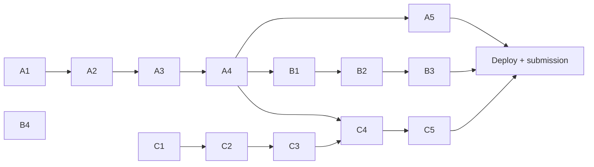

# 06. Implementation runbook

[Index](00_START_HERE.md) · [Contracts](05_DATA_CONTRACTS_AND_UI_INTEGRATION.md) · [Setup](07_SETUP_RUN_AND_DEPLOY.md)

## Rules

- One feature branch per track, merged into `main` before deploy. Tracks touch different files; the shared files are `docs/contratos.md`, `web/lib/artifact-types.ts` and `pipeline/src/firespire/config.py`: one person edits them at a time.
- Read `web/AGENTS.md` before writing Next.js code (Next 16 breaking changes).
- Artifacts are regenerated with `firespire build`, never edited by hand. After a build, restart `npm run dev` (artifacts are cached in memory).
- Baseline first: `uv run pytest`, `uv run ruff check` in `pipeline/`; `npm test`, `npm run lint`, `npm run build` in `web/`. Record any failure that exists before your change.

## Dependency map

B1–B4 and C1–C3 can start now on the 2023–2024 data already in the repo; they are re-run on the full archive after A4.

## Track A: data and harmonization

**Status 2026-11-15 15:00: A1–A5 done.** The archive arrived complete with the expected names and a per-source SP/NRT cutoff already applied, so no API backfill was needed. Artifacts `v2-full` are built and `latest.json` points to them. Results and open weaknesses are in [08](08_TESTING_FAILURES_AND_RELEASE.md#numbers-to-publish). Open: D-06 (k per calendar month), compression of `monthly.bin` (22.8 MB raw, 1.7 MB gzipped), A6 (globe years).

| Step | Work | Files | Estimate | Check |
|---|---|---|---|---|
| A1 | Receive the archive. Check names against [03](03_PROVIDER_API_IMPLEMENTATION.md#archive-files-history); rename if needed. Clip bbox downloads to Argentina. Put SP in `fuentes/sp/`. Check that no source has SP rows after its own SP cutoff | `fuentes/sp/` (not versioned if large) | 30 min | Every year has `modis_*`; `viirs-snpp_*` from 2012, `viirs-jpss1_*` from 2018, `viirs-jpss2_*` from 2023 [dates from `config.REGIMES`] |
| A2 | Add `--product sp|nrt` to `firespire fetch` (SP product names, output `fuentes/sp/`). Use it to fill SP gaps (e.g. S-NPP and NOAA-21 SP to 2026-07-31). Re-fetch NRT with `--after-sp` (each source from its own SP cutoff + 1) | `fetch.py`, `cli.py`, `tests/` | 45 min | No source/day with both SP and NRT rows |
| A3 | Satellite-completeness guard in `calibrate.compute`; `sp_months` counts months with rows; new fields `sp_months_incomplete`, `satellites_observed_sp`; warnings | `calibrate.py`, `config.py`, `tests/test_calibrate.py`, `web/lib/artifact-types.ts`, `docs/contratos.md` | 45 min | Unit test: a V3 month with N20 only is skipped |
| A4 | `uv run firespire build ../fuentes/sp ../fuentes/nrt --version v2-full` | `web/public/artifacts/v2-full/`, `latest.json` | 20–40 min (compute) | `meta.first_month` = 2000-11; `months_without_data` only real gaps; k for V1, V2, V3; holdout not skipped |
| A5 | Sanity checks and numbers for the pitch: k per regime, holdout MAPE and bias, S-NPP-drop result; ratio harmonized/MODIS in overlap months ≈ 1; size of `monthly.bin` (apply ADR 3 fallback if > 15 MB) | notes in `docs/` | 30 min | Numbers recorded in [08](08_TESTING_FAILURES_AND_RELEASE.md#numbers-to-publish) |
| A6 (optional) | `uv run firespire globe ../fuentes/sp ../fuentes/nrt --years 2000,2001,...,2025` (comma-separated) for the globe | `web/public/globe/data/` | 20 min | Globe year picker lists the new years |

## Track B: web core

| Step | Work | Files | Estimate | Check |
|---|---|---|---|---|
| B1 | Date range: two month selects; pass `from`/`to` to `monthlySeries`, KPIs and CSV link | `HistoryView.tsx`, `History.module.css` | 45 min | CSV for Córdoba 2024-08..2024-10 has only those months |
| B2 | `monthBaseline()` + comparison KPI + "Counts / Anomaly" toggle with a diverging CVD-safe ramp | `harmonize.ts`, `calendar-utils.ts`, `Calendar.tsx`, `HistoryView.tsx`, `lib/__tests__/lib.test.ts` | 1.5 h | Unit test on a fixture: median, `years`, `minYears` rule, provisional flag |
| B3 | Landing and wording: History is `/`; globe link "Explore raw detections"; method box explains k, regimes and holdout numbers; "Download chart" (SVG) | `page.tsx`, `HistoryView.tsx`, `MethodBox.tsx` | 45 min | No sentence suggests the globe is harmonized |
| B4 (cuttable) | `/api/v1/hotspots.csv` proxy per [05](05_DATA_CONTRACTS_AND_UI_INTEGRATION.md#hotspotscsv) | `web/app/api/v1/hotspots.csv/route.ts`, `web/lib/firms.server.ts`, `next.config.ts` (trace `provincias.geojson`) | 1–1.5 h | 10-day request for one province < 15 s; key never in logs or responses |

## Track C: curated museum

| Step | Work | Files | Estimate | Check |
|---|---|---|---|---|
| C1 | `firespire museum candidates` per [04 C1](04_DISCOVERY_AND_CAUSE_ENGINE.md#c1-candidates-from-the-data) | `museum.py`, `cli.py`, `config.py`, `tests/test_museum.py` | 1 h | 15 candidates with the diversity rule; deterministic order |
| C2 | Tavily curation of the shortlist (MCP or API), [04 C2](04_DISCOVERY_AND_CAUSE_ENGINE.md#c2-document-candidates-with-tavily) | — | 1–1.5 h (people) | ≥ 3 candidates with an opened, relevant source |
| C3 | Write `events.json` (3–5 events), [04 C3](04_DISCOVERY_AND_CAUSE_ENGINE.md#c3-human-review--eventsjson) | `pipeline/resources/museum/events.json` | 30 min | Pipeline validation passes |
| C4 | `firespire museum build` cross-match → `museum.json`, called from `build` | `museum.py`, `export.py`, `artifact-types.ts`, `docs/contratos.md` | 1 h | Each event has a verdict; numbers match a manual DuckDB query for one event |
| C5 | Museum adapter: `curated.mjs`, `curated-validate.mjs`, `mountMuseum(exhibits)`, source links, chart and context cards, footprint layer. **Needs D-14 approved** | `web/public/globe/museum/*`, `index.html` | 1.5–2 h | `npm run check:museum` passes; open each board; exit restores the camera |

## D1: deploy and submission (everyone, last 2 h)

1. Merge tracks, rebuild artifacts once on `main`, run all tests and `npm run build`.
2. Deploy to Vercel (Root Directory `web/`), set `FIRMS_MAP_KEY` in the server environment ([07](07_SETUP_RUN_AND_DEPLOY.md#deployment)).
3. Record the demo following [08](08_TESTING_FAILURES_AND_RELEASE.md#demo-script) and fill the submission page in English, declaring data (FIRMS, EONET if used), tools (Tavily, Claude Code, any Copilot use) and AI use.

## Cut line

| If at 19:00 … | Then |
|---|---|
| A4 not done | Stop B4, C5; everyone on Track A. Without the archive there is no core |
| B2 not done | Drop B4 and A6 |
| C3 has < 3 events | Ship 2 events or keep the fictional museum clearly labeled; do not ship a half-checked event |
| D-14 not approved | Keep the fictional museum, add a "Curated events (preview)" list on the History page showing `museum.json` numbers without the 3D board |
